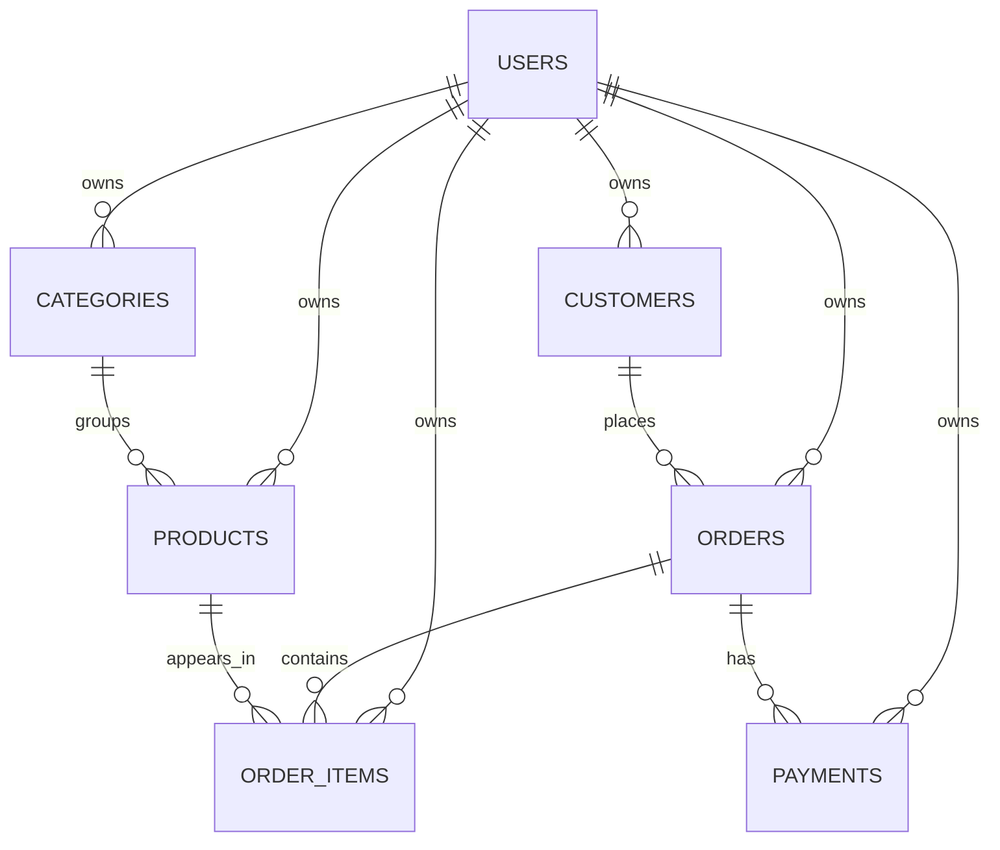

# DataScope

DataScope is an e-commerce analytics dashboard built to demonstrate Laravel API development, relational database design, SQL reporting, and a React interface. It turns store records into sales, product, customer, and inventory insights.

## Features

- Session-based registration, login, logout, and remembered sessions.
- Profile name editing and password changes with current-password validation.
- Account-scoped customers, categories, products, orders, order items, and payments.
- CRUD screens with search, pagination, validation, and relationship-aware forms.
- Analytics for revenue, paid orders, sales trends, best-selling products, category mix, top customers, order states, low stock, and payment states.
- Responsive dashboard, light/dark theme, loading, empty, and error states.
- CSRF protection for writes and throttling on registration and login.

## Stack

- Laravel 12 and PHP 8.2
- MySQL 8 (XAMPP works for local development)
- React 19, Vite 6, and CSS

## Data model

Every store row belongs to a user. The API scopes reads, writes, relationship validation, and analytics to the authenticated account. Product SKUs, category names, and customer emails are unique per account.



Revenue metrics include paid payments from non-cancelled orders and exclude orders with a refunded payment.

## Run locally on Windows

1. Create a MySQL database named `datascope_db` in phpMyAdmin (or use another MySQL database).
2. Configure Laravel:

   ```powershell
   cd backend
   Copy-Item .env.example .env
   composer install
   php artisan key:generate
   ```

   Set `DB_DATABASE`, `DB_USERNAME`, and `DB_PASSWORD` in `backend/.env` for your MySQL installation. The example defaults match a local XAMPP MySQL setup.

3. Run the forward migrations:

   ```powershell
   php artisan migrate
   ```

   These migrations preserve existing rows. Do not use `migrate:fresh` on a database that contains data.
   The ownership migration assigns legacy rows to the sole existing account when that is unambiguous. If there were multiple accounts, legacy rows remain unassigned and hidden from users until an owner is chosen.

4. Start the API from `backend`:

   ```powershell
   php artisan serve --host=127.0.0.1 --port=8000
   ```

5. In a second terminal, start React:

   ```powershell
   cd Frontend
   npm install
   npm run dev -- --host 127.0.0.1
   ```

6. Open the Vite URL (usually `http://127.0.0.1:5173`) and create an account. New accounts start with their own empty store. Add records in **Manage data**, or load the optional sample dataset below.

### Optional sample data

After creating an account, run the repeatable sample seeders from `backend`:

```powershell
php artisan db:seed
```

The seeders create 10 customers, 5 categories, 20 products, 30 orders, order items, and payments for one account. They update matching sample rows and do not delete records. If the database has more than one account, set `DATASCOPE_SEED_USER_ID` in `backend/.env` to the account ID that should own the sample data before seeding. With exactly one account, the seeders select it automatically. The sample transactions are fictional portfolio data.

## API overview

All application endpoints use the `/api` prefix. Authenticated routes use the Laravel session cookie; the React client sends credentials and CSRF tokens automatically.

| Area | Endpoints |
| --- | --- |
| Session | `GET /auth/csrf-token`, `POST /auth/register`, `POST /auth/login`, `GET /auth/user`, `PUT /auth/profile`, `PUT /auth/password`, `POST /auth/logout` |
| Dashboard | `GET /analytics/summary`, `/sales-trend`, `/top-products`, `/revenue-by-category`, `/top-customers`, `/orders-by-status`, `/low-stock`, `/payments-by-status` |
| Store records | `GET`, `POST /{resource}` and `GET`, `PUT`, `PATCH`, `DELETE /{resource}/{id}` for `customers`, `categories`, `products`, `orders`, `order-items`, and `payments` |

List endpoints support pagination (`per_page`, up to 100) and applicable filters. Products, customers, and categories also support `search`.

## Verification

The feature tests use SQLite in memory as configured in `backend/phpunit.xml`; they do not modify the local MySQL database.

```powershell
cd backend
php artisan test
```

Account-isolation coverage checks that users only see their own products, cannot access another account’s product by ID, cannot attach another account’s category, and receive account-specific dashboard totals. It also checks that analytics require authentication.

Build the frontend:

```powershell
cd Frontend
npm run build
```

## Project layout

```text
DataScope/
├── backend/     Laravel API, migrations, models, seeders, and feature tests
└── Frontend/    React dashboard and API client
```

## Portfolio deployment

DataScope uses fictional sample data. For a public deployment, configure production secrets outside version control, use HTTPS, set the frontend origin explicitly, and use production-grade MySQL and session storage settings.
